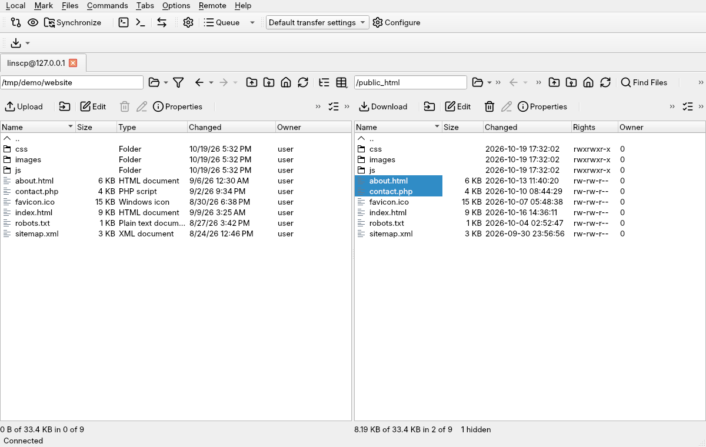
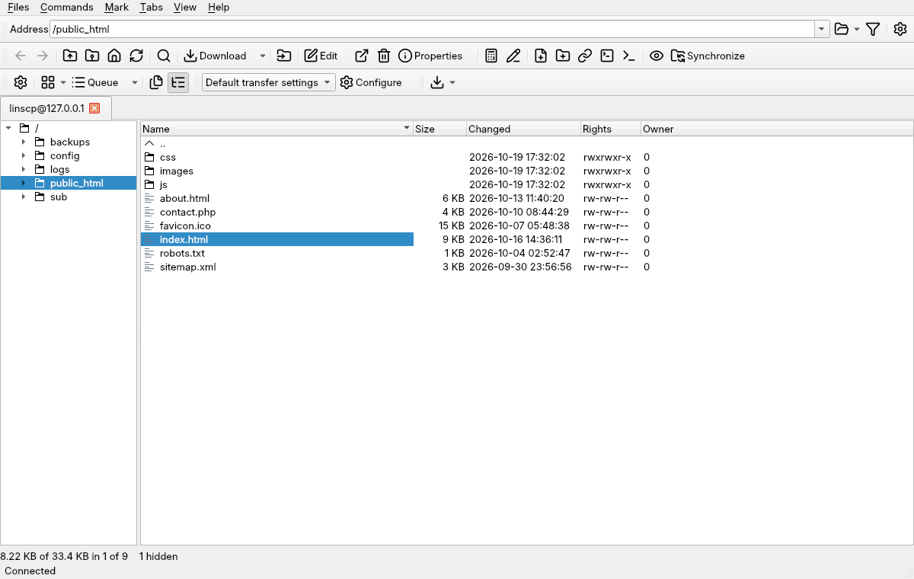
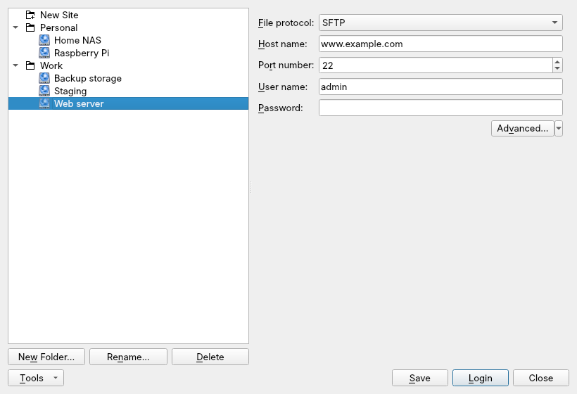
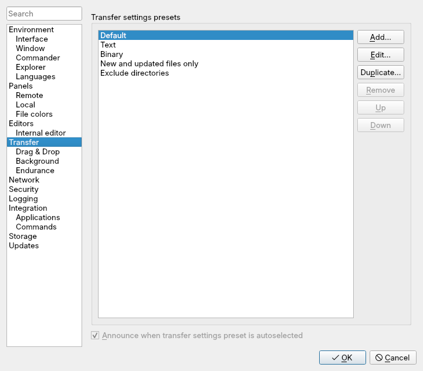
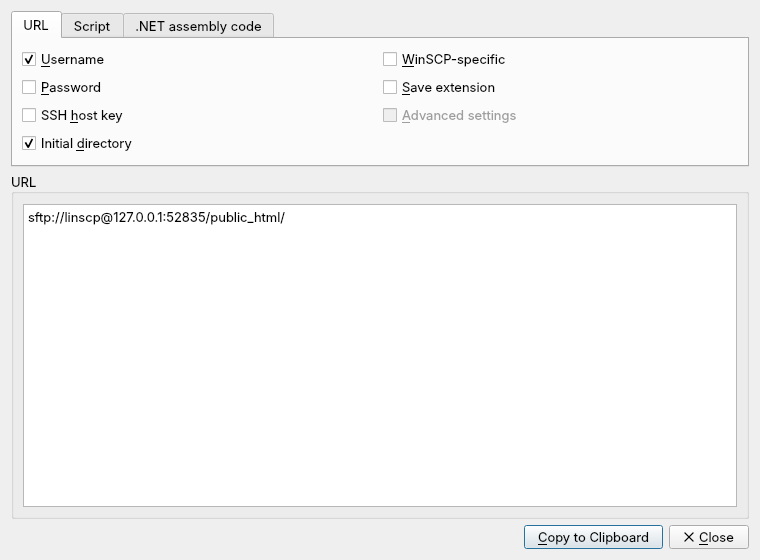

# linscp

**A free file manager for moving files between your computer and remote
servers, with the same interface on Linux and Windows.**

linscp shows your local files and a server's files side by side, so you can
copy, sync and edit them as easily as on your own disk. It runs on 64-bit Linux
and on Windows 10 and 11 (x64). Settings, sites and scripts work the same on
both.

Website and manual: **<https://linscp.org>** · Created and maintained by
[Eduardo Correia](https://github.com/99ecarvalho)

> **Pre-release (0.6.1).** Feedback and bug reports are very welcome.

| Explorer interface | Site Manager |
|---|---|
|  |  |
| **Preferences** | **Transfer presets** |
|  |  |
| **Session URLs and script code** | |
|  | |

## Features

- **Protocols:** SFTP, SCP, FTP, FTPS (explicit and implicit TLS), WebDAV
  and Amazon S3 compatible storage.
- **Two layouts:** Commander (local and remote panels side by side) or
  Explorer (the server only, with a folder tree).
- **Site Manager:** saved sites in folders, colours and notes, import from
  other clients, session URLs.
- **Transfers:** drag and drop, a background queue, resume, speed limits,
  transfer presets and text/binary modes.
- **Synchronization:** compare folders, sync in either direction, or keep a
  remote folder up to date as you work.
- **Remote editing:** open a server file in the built-in editor or your own;
  every save is uploaded.
- **Automation:** `linscp-cli`, a console client for scripts, cron jobs and
  CI, plus generated script code for any session.
- **Security:** SSH keys and agents, host key and certificate checks, a
  master password for saved passwords, client-side file encryption (SFTP).
- **53 interface languages**, and a portable mode that keeps settings beside
  the program.

## Download

Get the newest release at **<https://linscp.org/download/>**: `.deb`,
AppImage and Flatpak for Linux, an installer and a portable zip for Windows.
Older versions are on [GitHub Releases](https://github.com/99ecarvalho/linscp/releases).

## Documentation

The manual is at **<https://linscp.org/manual/>**: installing, connecting,
transfers, synchronization, scripting and security.

## Support

- Questions: [GitHub Discussions](https://github.com/99ecarvalho/linscp/discussions)
- Bugs: [GitHub Issues](https://github.com/99ecarvalho/linscp/issues)
- Security problems: report privately, see [SECURITY.md](SECURITY.md) or
  <https://linscp.org/security/>

linscp is free and community-funded. If it helps you,
[sponsor its development](https://linscp.org/donate/).

## Contributing

Building, testing and packaging are described in [DEVELOPERS.md](DEVELOPERS.md).

## Licence

linscp is free software under the GNU GPL, version 3: see [LICENSE](LICENSE).
Its transfer engine comes from WinSCP; linscp is an independent project, not
affiliated with or endorsed by the WinSCP project. Credits for all the
components linscp uses are at <https://linscp.org/manual/about/license-and-credits/>.
